<table>
    <tr>
        <td>
            
        </td>
        <td>
            
        </td>
        <td rowspan="2">
            
        </td>
    </tr>
    <tr>
        <td>
            
        </td>
        <td>
            
        </td>
    </tr>
</table>

<h2>Recent activity</h2>

<pre>
[+]─[29-09-2026]▶[<a href="https://github.com/Ex-iT/movie-feed-nuxt">movie-feed-nuxt</a>]
 └─ <a href="https://github.com/Ex-iT/movie-feed-nuxt/commit/5181ef541eb73b2194b1ed067e617607b90382bc">docs: update AGENTS.md for date, modal past state and design tokens</a>
[+]─[29-09-2026]▶[<a href="https://github.com/Ex-iT/movie-feed-nuxt">movie-feed-nuxt</a>]
 └─ <a href="https://github.com/Ex-iT/movie-feed-nuxt/commit/eab86d32b5f3ed4328b969b6cbc8921ccc78e98d">refactor: replace deep_link payload field with getProgrammeUrl util</a>
</pre>